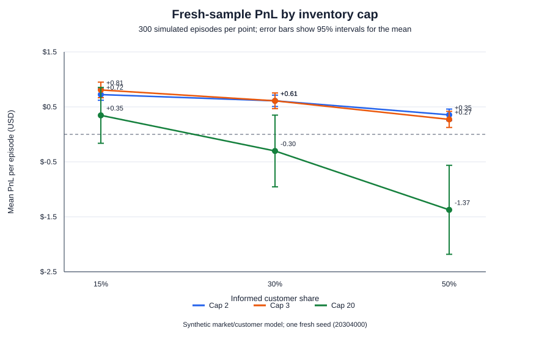

# Diagnosing a Binary-Options Market Maker

A synthetic stress study of a binary-options market-making bot. I examined its probability estimates, quote design, inventory limits, and performance under different simulated customer behaviors.

**Detailed report:** [Markdown Report](binary_options_mm_tutorial/PROJECT_REPORT.md) · [PDF Report](binary_options_mm_tutorial/Akuna_Binary_Options_Market_Maker_Report.pdf)

## Background and research questions

I competed in Akuna Capital's virtual trading competition on HackerRank. The bot received past prices through its `warm_up()` call, but I was unable to analyze that history effectively during the competition. Afterward, I built a synthetic market so I could examine the bot's estimates and trading decisions under conditions with known parameters.

This project studies three questions:

1. How accurately can the bot estimate a market from 30 or 120 days of prices?
2. How do its RFQ quotes perform when customers sometimes have better information than the bot?
3. Does a symmetric quote centered on fair value behave differently from the bot's original asymmetric regimes?

The price histories and customer behavior are synthetic. This project does **not** reproduce the Akuna competition, use its historical trade data, or establish live trading profitability.

## Method

I generated synthetic price histories for a FED index, AJR, and THR using known parameters. The bot estimates model parameters from the histories and uses them to estimate the payout probability of a binary option. I measure probability forecast accuracy with the **Brier score**.

For the trading experiments, I sent synthetic RFQs through the bot's quoting and position-update methods, varied the assumed share of informed customers, and settled contracts at expiry to calculate PnL. I also compared the original regime-based quote with a symmetric quote centered on fair value, and examined how inventory caps behaved across different random seeds.

## Main findings

- 30-day histories produced noisier drift estimates than 120-day histories. Shrinking the AJR drift estimate improved held-out Brier scores, but in the short-history case the adjusted bot still did not beat the 0.5 probability baseline.
- The original RFQ quote was strongly asymmetric. The symmetric `quote()` uses an 8-cent spread centered on estimated fair value, rounded to the nearest cent. It filled more often than the original regime-based quote in the simulated customer model, but neither policy showed a statistically clear PnL advantage under that model.
- The initial fine-grid sweep selected drift-shrinkage factors of λ = 0.05 for 30-day histories and λ = 0.18 for 120-day histories. In a three-seed robustness study using a coarser grid, λ = 0.08 and λ = 0.16 were selected most often for 30- and 120-day histories.
- The pooled inventory-cap analysis selected 2 contracts. However, one seed selected 20 and performed poorly out of sample, so the cap result remains provisional.

All findings depend on the synthetic market and customer assumptions described in the [full report](binary_options_mm_tutorial/PROJECT_REPORT.md).

## Selected figures




## Running the experiments

Requires Python 3.11 or later. The experiment scripts use the Python standard library.

From the repository root, enter the project directory:

```powershell
cd binary_options_mm_tutorial
```

Then run the main experiments:

```powershell
python parameter_diagnostic.py
python trading_stress_test.py
python quote_strategy_comparison.py
python robustness_study.py
```

To run the fresh fixed-cap validation:

```powershell
python final_cap_validation.py
```

The experiments use fixed random seeds and default to 300 episodes. Episode counts must be even and at least four. The first half of the episodes is used for calibration and parameter selection; the second half is held out for evaluation. Drift shrinkage tests λ from 0 to 1 in increments of 0.01. The inventory-cap sweep tests caps from 1 to 20 and selects a cap using average calibration PnL across three assumed informed-customer shares.

To change the run size or seed:

```powershell
python parameter_diagnostic.py --episodes 500 --seed 20300000
python trading_stress_test.py --episodes 500 --seed 20300000 --informed-fractions 0.15 0.30 0.50
```

The scripts write CSV results and charts into `parameter_results/` and `trading_results/`.

## Project files

### Code

- [Bot implementation](binary_options_mm_tutorial/akuna_bot.py) — local copy of the bot code analyzed in this project.
- [Initial probability and calibration experiment](binary_options_mm_tutorial/stress_test_akuna.py).
- [Parameter diagnostic](binary_options_mm_tutorial/parameter_diagnostic.py) — compares estimated parameters with the simulation's known parameters and plots Brier scores across AJR drift-shrinkage values.
- [Trading stress test](binary_options_mm_tutorial/trading_stress_test.py) — sends synthetic RFQs through the preserved original `quote_regime_based()` and `on_trade()` methods, settles positions at expiry, and compares raw estimates with drift-shrunk estimates.
- [Quote strategy comparison](binary_options_mm_tutorial/quote_strategy_comparison.py) — compares the symmetric fair-mid `quote()` with the preserved original `quote_regime_based()` on identical held-out paths and customer requests.
- [Robustness study](binary_options_mm_tutorial/robustness_study.py) — repeats parameter and inventory-cap sweeps across independent seeds.
- [Fresh cap validation](binary_options_mm_tutorial/final_cap_validation.py) — compares fixed caps 2, 3, and 20 on a fresh sample without choosing a cap based on that sample.
- [Beginner market-making simulator](binary_options_mm_tutorial/simulate.py) — a separate fixed-versus-inventory-aware quoting simulator; it does not call the Akuna bot.

### Reports and results

- [Full project report in Markdown](binary_options_mm_tutorial/PROJECT_REPORT.md) — detailed methods, results, assumptions, figures, and limitations.
- [Full project report in PDF](binary_options_mm_tutorial/Akuna_Binary_Options_Market_Maker_Report.pdf).
- [Parameter results](binary_options_mm_tutorial/parameter_results/) — parameter errors, estimates, drift-shrinkage scores, and robustness outputs.
- [Trading results](binary_options_mm_tutorial/trading_results/) — PnL and inventory metrics, paired comparisons, episode-level outputs, and charts.
- [Quote strategy metrics](binary_options_mm_tutorial/trading_results/quote_strategy_metrics.csv), [paired comparison](binary_options_mm_tutorial/trading_results/quote_strategy_paired_comparison.csv), and [PnL chart](binary_options_mm_tutorial/trading_results/quote_strategy_pnl.svg).
- [Drift-shrinkage Brier curve](binary_options_mm_tutorial/parameter_results/drift_lambda_brier_curve.svg) and [all tested shrinkage values](binary_options_mm_tutorial/parameter_results/drift_shrinkage.csv).
- [Inventory-cap metrics](binary_options_mm_tutorial/trading_results/inventory_cap_metrics.csv), [cap selection](binary_options_mm_tutorial/trading_results/inventory_cap_selection.csv), and [held-out PnL curve](binary_options_mm_tutorial/trading_results/inventory_cap_pnl_curve.svg).
- [Robustness seed summary](binary_options_mm_tutorial/robustness_seed_summary.csv), [selection frequency](binary_options_mm_tutorial/robustness_selection_frequency.csv), [cap results across seeds](binary_options_mm_tutorial/robustness_cap_across_seeds.csv), and [robustness chart](binary_options_mm_tutorial/robustness_cap_curve.svg).
- [Fresh cap-validation episode data](binary_options_mm_tutorial/trading_results/final_cap_validation_episodes.csv), [summary metrics](binary_options_mm_tutorial/trading_results/final_cap_validation_summary.csv), [paired comparisons](binary_options_mm_tutorial/trading_results/final_cap_validation_paired.csv), and [PnL chart](binary_options_mm_tutorial/trading_results/final_cap_validation_pnl.svg).
- [Beginner simulator results](binary_options_mm_tutorial/results.csv), [PnL data](binary_options_mm_tutorial/pnl_curve.csv), and [PnL chart](binary_options_mm_tutorial/pnl_curve.svg).

## Fresh fixed-cap validation

The fresh validation compares preselected caps 2, 3, and 20 on 300 fresh episodes using seed `20304000`. It does not select a cap based on those results. It writes per-episode records, summary metrics, paired comparisons, and a PnL chart to `trading_results/`. The results and interpretation are documented in the [project report](binary_options_mm_tutorial/PROJECT_REPORT.md).

## Scope and limitations

The bot did receive past market values through `warm_up()` during the competition. The issue examined here is that I was unable to analyze that history effectively at the time. This project uses synthetic histories and outcomes, not the competition's historical data.

The RFQ studies use the bot's quoting and trade-position update methods, but do not simulate the original Akuna environment. In particular, they do not model FOK order flow, competition scoring, fees, multiple simultaneous options, or data-driven customer behavior. The informed-customer and noise-customer rules are assumptions in the simulator.

The results should be interpreted as controlled synthetic experiments, not as a reconstruction of the competition or evidence of real-market performance.
