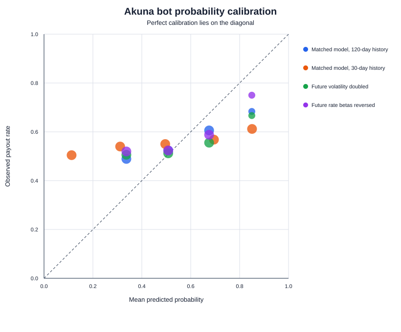
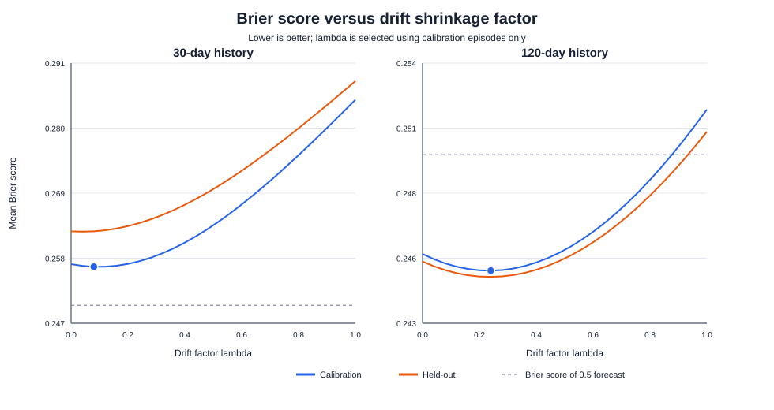
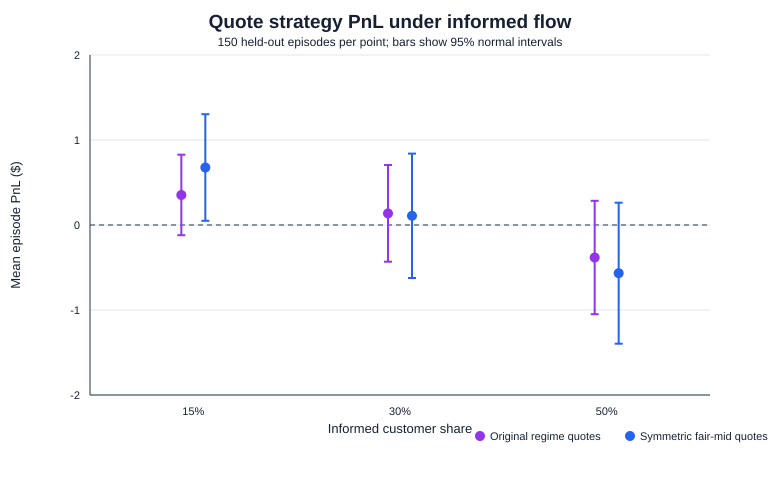

# Diagnosing a Binary-Options Market Maker

A synthetic stress study of a binary-options market-making bot. I examined its probability estimates, quote design, inventory limits, and performance under different simulated customer behaviors.

[`PROJECT_REPORT.md`](binary_options_mm_tutorial/PROJECT_REPORT.md) You may find the entire project report here, with a detailed explanation of everything relevant
## Background

I competed in Akuna Capital's virtual trading competition on HackerRank. The bot received past prices during its `warm_up()` call, but I was unable to analyze that history effectively during the competition. Afterward, I built a synthetic market so I could inspect how the bot's estimates and trading decisions behaved under conditions with known parameters.

This project does **not** reproduce the competition or use its historical trading data. All market paths and customer behavior in the experiments are synthetic.

## Questions studied

- How does the length of price history affect the bot's parameter estimates?
- Does shrinking the estimated AJR drift improve option-probability forecasts?
- How do the bot's original regime-based quotes compare with a symmetric quote centered on fair value?
- How does inventory capacity affect simulated PnL, and how stable are the results across random seeds?

## Method

I generated synthetic FED, AJR, and THR price histories with known dynamics. I used the histories to estimate model parameters, then evaluated probability forecasts with the **Brier score** on held-out simulations.

For the trading experiments, I sent synthetic RFQs through the bot's quoting and position-update logic, varied the assumed share of informed customers, and settled contracts at expiry. I also tested inventory caps across multiple seeds.

## Main findings

- Shorter histories produced noisier drift estimates. Shrinking the AJR drift estimate improved held-out Brier scores, but in the short-history case the adjusted bot did not outperform the 0.5 probability baseline.
- The symmetric quote used an 8-cent spread centered on estimated fair value. It filled more often than the original regime-based quote in the simulated customer model, but neither policy showed a statistically clear PnL advantage.
- The initial fine-grid sweep selected drift-shrinkage factors of λ = 0.05 for 30-day histories and λ = 0.18 for 120-day histories. In a three-seed robustness study on a coarser grid, λ = 0.08 and λ = 0.16 were selected most often.
- The pooled inventory-cap analysis selected 2 contracts, but one seed selected 20 and performed poorly out of sample. I therefore treat the cap result as uncertain rather than a universal optimum.

These findings describe only the simulations and assumptions in this project. They are not evidence of live trading profitability.

## Selected figures







## Run the experiments

Requires Python 3.11 or later. The scripts use the Python standard library.

From the repository root, first enter the project folder:

```powershell
cd binary_options_mm_tutorial
```

Then run:

```powershell
python parameter_diagnostic.py
python trading_stress_test.py
python quote_strategy_comparison.py
python robustness_study.py
python final_cap_validation.py
```

The scripts write CSV results and charts into `parameter_results/` and `trading_results/`.

## Project files

- `akuna_bot.py` — bot implementation analyzed in this project.
- `parameter_diagnostic.py` — parameter estimation and drift-shrinkage experiments.
- `trading_stress_test.py` — synthetic RFQ and inventory stress tests.
- `quote_strategy_comparison.py` — comparison of the original and symmetric quote policies.
- `robustness_study.py` — repeats parameter and inventory-cap sweeps across seeds.
- `final_cap_validation.py` — compares selected inventory caps on a fresh sample.
- `parameter_results/` — parameter-analysis results and charts.
- `trading_results/` — trading-analysis results and charts.

## Limitations

The market dynamics, price histories, and customer behaviors are generated by the simulator. The experiments do not model the full Akuna competition environment, including its FOK order flow, competition scoring, fees, multiple simultaneous options, or data-driven customer behavior. The results should be interpreted as controlled synthetic experiments, not as a reconstruction of the competition.
