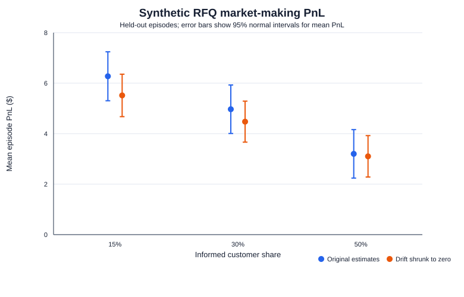
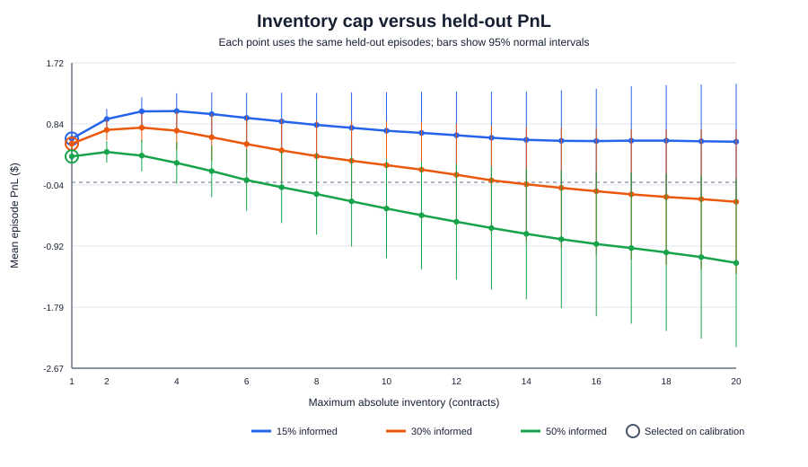
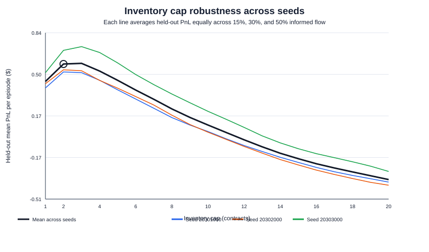
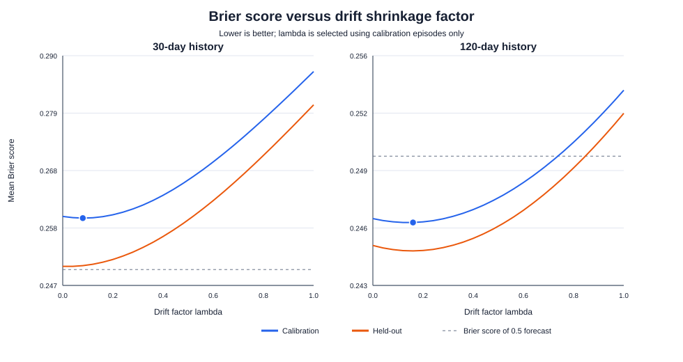
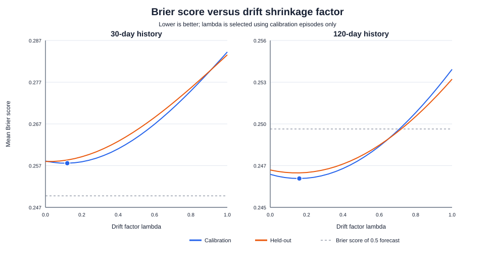
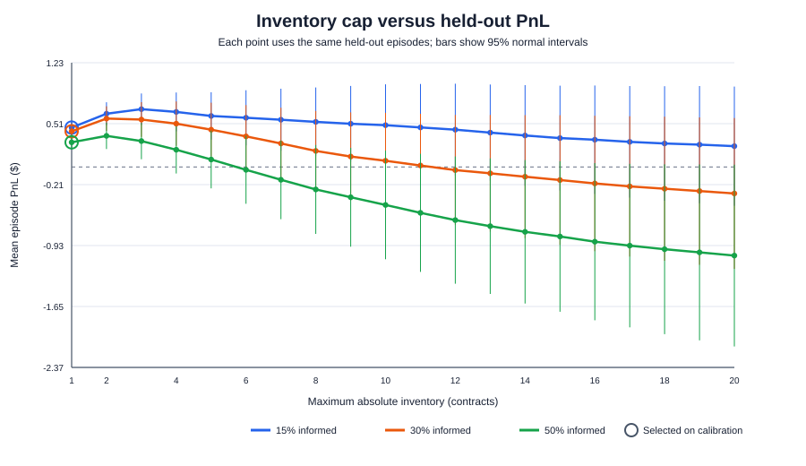
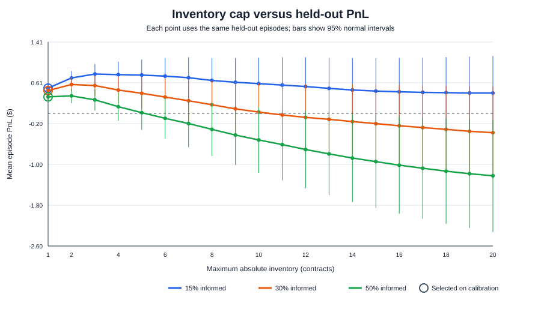

# Diagnosing a Binary-Options Market Maker with a Synthetic Market

## 1. Background and objective

I competed in Akuna Capital's virtual trading competition on HackerRank in August. The bot received past market values through its `warm_up()` call, but during the competition I did not know how to analyse that history well enough to make useful decisions from it. I built the bot while competing, and its performance was not what I had hoped for. After the event, I wanted to understand what the bot was doing and which parts of its design might have limited it.

I focused on a binary-options market-making bot. Its warm-up routine estimates parameters from recent prices, uses those estimates to predict the chance that an option pays out, and then places bids and asks around the resulting fair value. This gave me several concrete questions to investigate: how noisy are the estimates when the bot has only a short history; does reducing the influence of a noisy drift estimate improve the probability forecasts; does the original quote method keep its prices centred on the bot's fair value; and how does limiting inventory affect PnL when more customers know the option's true valueλ

I did not have a competition dataset that I could use for this analysis, so I built a synthetic market with explicit rules and parameters. I generated price histories, future paths, and customer requests, then compared the bot's estimates with the values used by the simulator. I measured forecast quality with the Brier score and trading outcomes with simulated PnL. I tested parameter shrinkage, a symmetric quote around fair value, and inventory caps, using separate calibration and held-out episodes where applicable. In later tests I changed the random seed and evaluated candidate inventory caps on a fresh sample.

This is not a replay of the HackerRank competition and does not establish the cause of the competition result. The competition bot did receive warm-up history; the problem was that I could not make effective use of it at the time. The synthetic experiments let me examine the bot under conditions I can describe and control, and show how its estimation, quoting, and inventory decisions interact when the market and customer behaviour follow the stated assumptions.
## 2. Bot and contract being analysed

The bot estimates the behaviour of three underlyings: a synthetic FED interest-rate index, AJR, and THR. The forecast experiments focus on one-leg AJR binary options. A contract pays $1 at expiry when AJR is at or above its strike and $0 otherwise. If the estimated probability of payout is 0.60, the corresponding theoretical value is $0.60 before spreads, fees, and inventory risk.

The bot’s `warm_up()` routine estimates parameters from historical price series. It estimates rate sensitivities using ordinary least squares, removes the estimated rate effect from company returns, and uses the residuals to estimate drift and volatility. Sector sensitivities are fixed at 1.0 in the bot; they are not estimated from the history. The bot then uses its estimated parameters to price options and generate quotes. In practical terms, the warm-up step turns a finite block of observed prices into inputs for the model; errors in those inputs can therefore affect both the estimated option value and the quote that follows. The synthetic tests let me separate that estimation question from the later trading question.

The competition bot’s original `quote_regime_based()` method uses probability-dependent regimes. In some regions it places a bid near fair value and an offer far above it; in others it places a very low bid and an offer closer to fair value. In this project I preserve that method as the original quote policy. I also tested a separate symmetric `quote()` policy centred on the bot’s fair value.

## 3. Constructing the synthetic market

### 3.1 Why I used a synthetic process

The HackerRank bot did receive past market values through `warm_up()`. I was not able to analyse that history effectively during the competition, and I have not used the competition history or trade outcomes in this study. Instead, I constructed a market process with known parameters. This lets me control how the data is generated and compare the bot’s estimates and forecasts with the parameter values and outcomes known to the simulator.

I used the bot’s own default structure for the interest-rate transition and for several baseline parameters. That choice kept the synthetic process connected to the model the bot was designed to understand. I then selected non-zero rate sensitivities and explicit volatility levels so that rate changes and shared market shocks could affect AJR and THR. These values are experimental assumptions; they are not estimates from Akuna data.

### 3.2 FED index and company-price dynamics

Each generated history begins with the FED index at 2.0 and AJR and THR at $100. The rate index moves on a 0.25-point grid. Its base daily probabilities are 0.25 for an increase and 0.20 for a decrease; the remaining probability leaves it unchanged. To make the process mean-reverting, I used the bot’s default target of 2.0 and reversion strength of 0.1. At rate level `r`, the transition probabilities are adjusted by the tilt `0.1 × (2.0 − r)`: a rate below target makes an increase more likely, while a rate above target makes a decrease more likely. Probabilities are clipped so they remain valid, and the rate cannot fall below zero.

I chose these rate dynamics because they are the bot’s own discrete, mean-reverting rate model, rather than an unsupported guess about real FED data. Reusing that structure also allowed me to test whether the bot could estimate parameters from a process similar to the one it assumes. Each step represents one simulated day.

For each company, I generated the daily log return as:

> daily log return = drift + (rate sensitivity × daily rate change) + (sector sensitivity × shared sector shock) + company-specific shock

The shared sector shock creates correlated moves in AJR and THR; the company-specific shocks create independent variation. Prices are updated exponentially and rounded to cents after each daily step. I generated 120 observations per historical path. The simulator keeps the parameter values fixed within a history, while the shocks and rate transitions vary randomly from day to day. As a result, separate histories share the same generating rules but do not contain identical price paths. This is important for the later held-out comparisons: they test the bot on new realizations of the same specified process.

| Ground-truth parameter | AJR | THR |
|---|---:|---:|
| Daily drift | 0.0008 | 0.0012 |
| Rate sensitivity | -0.020 | 0.012 |
| Sector sensitivity | 1.0 | 1.0 |
| Company-specific shock standard deviation | 0.010 | 0.012 |

The shared sector shock standard deviation is 0.015. Rate step, target, mean-reversion strength, and base up/down probabilities are 0.25, 2.0, 0.1, and 0.25/0.20, respectively. I refer to these as ground-truth parameters only in the sense that they are the values used by my simulator; they are not claims about real market parameters.

## 4. Forecast and parameter-estimation experiments

### 4.1 Option set and forecast scoring

At the end of each 120-day path, I priced six AJR binary options: 5- and 10-day maturities, each with a strike 1% below, at, or 1% above the current AJR price. I generated future paths from the same process to determine whether each contract paid $1 or $0.

I measured probability accuracy with the Brier score, the mean squared difference between predicted probability and binary outcome. Lower scores indicate more accurate probability forecasts. A constant 0.5 forecast has a Brier score of 0.25. I also grouped forecasts by predicted probability and compared each group’s mean prediction with its observed payout rate; perfect calibration lies on the diagonal.


Each dot groups forecasts with similar predicted probabilities. The horizontal position is the bot’s mean prediction and the vertical position is the observed payout rate; closeness to the diagonal indicates calibration. The four colours represent the matched 120-day case, matched 30-day case, doubled future volatility, and reversed future rate sensitivities. The calibration bins summarize predictions from the original probability stress test; they are not separate observations for each future path.

### 4.2 Stress scenarios and initial probability results

I evaluated four cases: matched training and future processes with 120 days of history; the same process with only the latest 30 days used for training; future volatility doubled relative to training; and both future company rate sensitivities reversed. The doubled-volatility case doubles the company-specific and sector shock standard deviations. The rate-reversal case changes the signs of both company rate sensitivities after training.

The initial probability experiment used 100 generated histories and 20 future paths per option forecast. A shrinkage factor was selected using the first half of the episodes and evaluated on the second half. The split prevents the reported held-out score from also being the score used to choose the shrinkage setting. An episode here means one generated historical path, one fitted warm-up estimate, and the associated option forecasts and simulated future paths; it is the history-level unit being split. For a raw probability `p`, the adjusted probability is `0.5 + λ × (p − 0.5)`: λ=1 leaves the forecast unchanged, while λ=0 moves it to 0.5.

| Scenario | Raw Brier | Brier after shrinkage | Selected λ |
|---|---:|---:|---:|
| Matched, 120-day history | 0.2516 | 0.2458 | 0.50 |
| Matched, 30-day history | 0.2833 | 0.2500 | 0.00 |
| Future volatility doubled | 0.2605 | 0.2489 | 0.25 |
| Future rate sensitivities reversed | 0.2554 | 0.2476 | 0.25 |

Shrinkage improved the held-out Brier score in each of these four scenarios. In the short-history case, it selected λ=0, which is equivalent to the constant 0.5 forecast. This initial result motivated a more focused test of drift shrinkage with a larger set of histories and a denser λ grid.

### 4.3 Parameter recovery and drift shrinkage

For the parameter study, I generated 300 independent 120-day histories. I fitted the bot using either the most recent 30 observations or all 120 observations, then compared the estimates with the simulator’s known parameters.

| Parameter | Truth | 30-day mean estimate | 30-day MAE | 30-day SD | 120-day mean estimate | 120-day MAE | 120-day SD |
|---|---:|---:|---:|---:|---:|---:|---:|
| AJR drift | 0.0008 | 0.001104 | 0.002619 | 0.003226 | 0.000813 | 0.001296 | 0.001615 |
| THR drift | 0.0012 | 0.001421 | 0.002651 | 0.003375 | 0.001304 | 0.001382 | 0.001735 |
| AJR rate sensitivity | -0.0200 | -0.021055 | 0.016498 | 0.020429 | -0.020299 | 0.007592 | 0.009535 |
| THR rate sensitivity | 0.0120 | 0.010311 | 0.016509 | 0.020505 | 0.011625 | 0.008030 | 0.010120 |
| Sector shock SD | 0.0150 | 0.014258 | 0.002164 | 0.002639 | 0.014840 | 0.001022 | 0.001271 |
| AJR company shock SD | 0.0100 | 0.009535 | 0.002327 | 0.003003 | 0.009955 | 0.001014 | 0.001281 |
| THR company shock SD | 0.0120 | 0.011363 | 0.002181 | 0.002789 | 0.011803 | 0.000998 | 0.001233 |

MAE is the mean absolute error across histories; SD is the standard deviation of the estimate across histories. The 30-day estimates were noisier for every parameter shown. In particular, the dispersion of the drift estimates was large relative to the small daily drift used to generate prices. This is one mechanism that can make a short-history forecast unstable in the simulator.

I then varied AJR’s drift shrinkage factor λ from 0 to 1 in increments of 0.01. I selected λ on the first 150 histories and measured its Brier score on the remaining 150. I did this separately for 30-day and 120-day training histories. The parameter is applied to the estimated AJR drift before calculating option probabilities; it does not alter the rate-sensitivity or volatility estimates. A value near zero deliberately gives up some responsiveness to the fitted drift in exchange for less sensitivity to estimation noise.

| Training history | Selected λ | Calibration Brier | Held-out Brier after shrinkage | Held-out Brier with raw drift | 0.5 baseline |
|---|---:|---:|---:|---:|---:|
| 30 days | 0.05 | 0.2561 | 0.2573 | 0.2810 | 0.2500 |
| 120 days | 0.18 | 0.2456 | 0.2437 | 0.2509 | 0.2500 |


Each panel uses a different training-history length. The horizontal axis is λ and the vertical axis is mean Brier score; lower is better. The calibration curve shows the data used to select λ, while the held-out curve evaluates the selected setting on different histories. The dashed line is the 0.5 forecast baseline. The 120-day result beat that baseline; the 30-day result did not, even though shrinkage improved it relative to raw drift.

Across histories, absolute AJR drift-estimation error was positively associated with raw AJR Brier score in this run (correlations +0.562 for 30-day and +0.604 for 120-day histories). The corresponding rate-sensitivity correlations were +0.028 and -0.011. These are exploratory associations and do not show that drift error alone caused forecast error.

## 5. RFQ trading simulation and PnL accounting

### 5.1 Episode and customer-flow construction

A trading episode begins from a generated historical path. The bot receives 30 days of history, warms up its estimates, and trades one of six AJR options, cycling through the 5- and 10-day maturities and the three strike locations. The market is advanced day by day until expiry. The simulator requests eight quotes per day. Each customer is randomly assigned to buy or sell and requests between one and three contracts.

I varied the assumed share of informed customers across 15%, 30%, and 50%. An informed customer compares the quote with the option’s fair probability under the parameters that generated the market. The customer buys only if that true fair value exceeds the bot’s ask by at least $0.01; the customer sells only if true fair value is at least $0.01 below the bid. The remaining customers are treated as noise traders. These customer rules are assumptions for the simulation; I do not have competition customer-flow records to use for estimating them.

The first drift-ablation experiment used a 30% noise-customer fill probability independent of spread. In the later quote-policy and cap experiments, I used a spread-sensitive noise fill probability: 30% at an 8-cent spread, falling exponentially as the spread widens, with elasticity 8 and a maximum probability of 80%. The two fill models belong to different experiments and should not be treated as a single calibrated estimate of customer behaviour. In particular, a fill probability that ignores spread cannot show whether widening a quote reduces noise-trader activity. I used it only for the paired drift ablation, where the aim was to compare two parameter treatments under the same simple fill rule.

### 5.2 Cash, inventory, and settlement

For every fill, the simulator updates cash and the bot’s position. If the bot buys `q` contracts at price `P`, its cash decreases by `Pq` and its position increases by `q`; a sale does the reverse. At expiry, a winning contract pays $1 and a losing contract pays $0. Episode PnL is therefore:

> PnL = trading cash flow + ending position × expiry payout

PnL is reported relative to zero starting trading cash; the bot’s $100,000 starting cash is not counted as profit. For the inventory-cap sweeps, the simulator clips executed quantity so the absolute position cannot exceed the tested cap. This hard execution limit is part of the simulator: the bot’s quote object itself requires positive quantities on both sides and may still display a one-contract quote when a position-side limit is reached.

### 5.3 Drift-ablation PnL

For the first PnL comparison, I preserved the original `quote_regime_based()` method so that the drift experiment remained comparable with the original competition bot. The study used the 150 held-out histories from the 300-history parameter run. For each history, I compared raw parameter estimates with an otherwise identical bot whose AJR drift estimate was set to zero. Both policies experienced the same underlying path and customer-event draws.

| Informed customers | Policy | Mean PnL / episode | PnL SD | Profitable episodes | Fill rate | Mean peak inventory |
|---:|---|---:|---:|---:|---:|---:|
| 15% | Raw estimates | $6.273 | $6.062 | 83.3% | 28.3% | 9.03 |
| 15% | Drift shrunk to zero | $5.514 | $5.262 | 83.3% | 28.2% | 9.07 |
| 30% | Raw estimates | $4.967 | $5.997 | 81.3% | 27.0% | 10.01 |
| 30% | Drift shrunk to zero | $4.475 | $5.078 | 80.0% | 26.5% | 9.35 |
| 50% | Raw estimates | $3.200 | $6.001 | 72.0% | 24.5% | 11.32 |
| 50% | Drift shrunk to zero | $3.102 | $5.119 | 75.3% | 23.8% | 10.35 |

The raw-minus-shrunk paired mean PnL differences were $0.758 at 15% informed flow (95% interval [$0.204, $1.312]), $0.492 at 30% ([-$0.252, $1.236]), and $0.097 at 50% ([-$0.821, $1.016]). Only the 15% interval excluded zero. In this experiment, the shrinkage that improved forecast Brier scores did not produce a clear trading-PnL improvement. Forecast accuracy and market-making PnL are different outcomes: quote placement, customer selection, spread capture, inventory, and settlement all intervene.



At each informed-customer share, the two points compare the raw estimates with zeroed AJR drift. The error bars show 95% intervals for average PnL. The decline in mean PnL as informed share rises is visible for both policies under this particular customer model.

## 6. Quote-policy analysis

### 6.1 What changed in the quote

The original regime-based quote did not maintain a consistent spread around fair value. In the initial controlled comparison it had a mean spread of $0.464 and its quote midpoint averaged $0.107 below the bot’s fair value. I changed the default quote to a symmetric eight-cent spread: round estimated fair value to the nearest cent, quote four cents below and above that centre, and clip prices to the valid $0–$1 range. This keeps the displayed midpoint near fair value. Inventory is controlled through quoted size and a separate execution cap rather than by moving the midpoint.

### 6.2 Controlled quote comparison

I compared the original regime-based and symmetric fair-mid policies on the same synthetic histories and customer requests, using a common 12-contract inventory limit. The result uses 150 held-out episodes for each customer-flow setting. The symmetric policy attracted more fills in every scenario and brought the midpoint error close to zero, but the PnL difference varied with the assumed informed share.

| Informed customers | Quote policy | Mean PnL | Mean spread | Mean midpoint error | Fill rate | Mean peak inventory |
|---:|---|---:|---:|---:|---:|---:|
| 15% | Original regime-based | $0.466 | $0.464 | -$0.107 | 12.6% | 5.54 |
| 15% | Symmetric fair-mid | $0.621 | $0.074 | -$0.0004 | 30.3% | 9.19 |
| 30% | Original regime-based | $0.172 | $0.464 | -$0.107 | 13.4% | 6.49 |
| 30% | Symmetric fair-mid | -$0.002 | $0.074 | -$0.0004 | 28.6% | 10.05 |
| 50% | Original regime-based | -$0.131 | $0.464 | -$0.107 | 12.6% | 7.40 |
| 50% | Symmetric fair-mid | -$0.503 | $0.074 | -$0.0004 | 24.2% | 10.85 |

The paired symmetric-minus-original PnL differences were +$0.156 at 15% informed flow (95% interval [-$0.265, $0.577]), -$0.174 at 30% ([-$0.649, $0.301]), and -$0.372 at 50% ([-$0.853, $0.110]). All three intervals included zero. The test therefore shows a clear change in quote geometry, not a statistically clear PnL improvement. The higher fill rate is consistent with the narrower quotes being easier for customers to trade against, but it also means the bot accumulated more exposure. The PnL comparison is consequently the more relevant check of whether the geometric change helped under each assumed customer mix.


The purple and blue points compare the two quote policies at 15%, 30%, and 50% informed flow; error bars are 95% intervals. The symmetric quote is much closer to fair value at the midpoint, while mean PnL depends on the customer mix and does not establish one policy as superior.

## 7. Inventory-risk analysis

### 7.1 Full cap sweep

After changing the quote, I held its width and the simulated market/customer paths fixed and varied the maximum absolute position from 1 to 20 contracts. I selected one cap using average calibration PnL across the 15%, 30%, and 50% flow scenarios, then evaluated it on the other half of the episodes. On the initial seed, the calibration choice was cap 3.

| Informed customers | Selected cap | Calibration mean PnL | Held-out mean PnL | 95% interval | Profitable episodes | Fill rate | Mean peak inventory |
|---:|---:|---:|---:|---:|---:|---:|---:|
| 15% | 3 | $0.792 | $0.759 | [$0.562, $0.955] | 68.7% | 24.9% | 3.00 |
| 30% | 3 | $0.544 | $0.639 | [$0.438, $0.839] | 64.0% | 22.6% | 3.00 |
| 50% | 3 | $0.195 | $0.345 | [$0.140, $0.551] | 58.7% | 18.1% | 3.00 |



The x-axis varies the cap from 1 to 20 contracts. The three lines hold customer mix at 15%, 30%, or 50% informed flow; all use the same held-out episodes. Error bars show 95% intervals, and the ring marks the cap selected on calibration data. PnL falls as informed flow rises, while a wider cap permits larger positions.

### 7.2 Multi-seed robustness

A single train/test split can make a cap appear better by chance. I repeated the parameter and cap studies using three fresh seeds, with 300 episodes per seed and 150 calibration/150 held-out episodes. For this robustness run, λ was tested in increments of 0.04 rather than 0.01. The inventory sweep still tested caps 1 through 20. Each seed selected its settings using its calibration episodes only.

| Seed | Selected λ, 30-day | Held-out Brier, 30-day | Selected λ, 120-day | Held-out Brier, 120-day | Selected cap | Selected-cap held-out mean PnL |
|---:|---:|---:|---:|---:|---:|---:|
| 20301000 | 0.08 | 0.2507 | 0.16 | 0.2445 | 2 | $0.524 |
| 20302000 | 0.12 | 0.2585 | 0.16 | 0.2470 | 20 | -$0.397 |
| 20303000 | 0.08 | 0.2626 | 0.24 | 0.2447 | 2 | $0.699 |

The 120-day held-out scores were below 0.25 in all three seeds; the 30-day scores were not. All selected λ values improved held-out Brier score relative to raw drift in their respective run. Cap selection was less stable: cap 2 was selected twice and cap 20 once. Pooling calibration results across seeds and weighting the three flow assumptions equally selected cap 2. Cap 3 was nearly tied in pooled calibration PnL ($0.544 versus $0.551 for cap 2), and pooled held-out PnL was also nearly tied ($0.593 for cap 3 versus $0.588 for cap 2). The distinction between these two low caps is small compared with the instability of the wide-cap result. The three seeds therefore support a practical observation: a low cap often limited losses in these runs, but the results do not identify a universally best cap. The cap of 20 selected in one calibration sample is a useful warning that choosing the maximum from a noisy curve can overfit that sample.



Each coloured line is one seed’s held-out mean PnL, averaged equally over 15%, 30%, and 50% informed flow; the black line is the average across seeds. The horizontal axis is cap. Separation among the lines shows sensitivity to which synthetic histories and customer paths were generated.

#### Drift-shrinkage curves by seed

These three plots use the same design: separate panels for 30-day and 120-day histories, Brier score on the vertical axis, and λ on the horizontal axis. Blue is calibration, orange is held out, and the dashed line is the 0.5 forecast baseline. Only the random seed changes across plots; each run tests λ from 0 to 1 in increments of 0.04.



Seed 20301000 selected λ=0.08 for 30-day history and λ=0.16 for 120-day history.



Seed 20302000 selected λ=0.12 for 30-day history and λ=0.16 for 120-day history.


Seed 20303000 selected λ=0.08 for 30-day history and λ=0.24 for 120-day history. The selected value shifts between random samples, particularly for the longer history.

#### Inventory-cap curves by seed

Each plot shows held-out PnL versus cap for the same three assumed informed-customer shares, with error bars for the held-out mean. The ring marks the cap selected using that seed’s calibration episodes. The customer percentages and cap range are the same across the figures; the random seed and resulting paths differ.



Seed 20301000 selected cap 2.



Seed 20302000 selected cap 20. Its held-out result for the selected cap was negative on average, driven by the 30% and 50% informed-flow cases.


Seed 20303000 selected cap 2.

### 7.3 Fresh fixed-cap validation

I next fixed three candidate caps in advance (2, 3, and 20) and evaluated them on a new seed, 20304000. This run used 300 fresh episodes and did not select a cap from those results. Within each episode, all three caps saw the same market path and customer events. I repeated the comparison at the same 15%, 30%, and 50% informed-customer shares. This paired design isolates the effect of changing the cap within the simulator.

| Informed customers | Cap | Mean PnL / episode | 95% interval for mean | Profitable episodes | Mean peak inventory |
|---:|---:|---:|---:|---:|---:|
| 15% | 2 | $0.724 | [$0.620, $0.828] | 81.3% | 2.00 |
| 15% | 3 | $0.808 | [$0.666, $0.950] | 77.0% | 3.00 |
| 15% | 20 | $0.345 | [-$0.162, $0.853] | 58.0% | 11.01 |
| 30% | 2 | $0.610 | [$0.506, $0.714] | 76.3% | 2.00 |
| 30% | 3 | $0.610 | [$0.467, $0.753] | 70.0% | 3.00 |
| 30% | 20 | -$0.302 | [-$0.954, $0.350] | 55.0% | 12.88 |
| 50% | 2 | $0.355 | [$0.250, $0.460] | 67.0% | 2.00 |
| 50% | 3 | $0.272 | [$0.126, $0.419] | 61.0% | 2.99 |
| 50% | 20 | -$1.373 | [-$2.182, -$0.564] | 52.7% | 14.82 |


Each line keeps cap fixed at 2, 3, or 20 and moves across the three customer-flow assumptions. The wide cap’s average PnL declines as informed flow rises, alongside much higher peak inventory. Caps 2 and 3 remain closer, with the relative result depending on customer mix.

The paired cap-3-minus-cap-2 PnL differences were +$0.084 at 15% informed flow (95% interval +$0.029 to +$0.139), approximately zero at 30% ([-$0.056, +$0.057]), and -$0.083 at 50% ([-$0.138, -$0.027]). Cap 3 did better in the low-informed case, the two were indistinguishable in the middle case, and cap 2 did better in the high-informed case. This new sample supports the conclusion that low caps controlled exposure under the tested assumptions; it does not show one low cap to be optimal for all customer mixes.

## 8. Findings and interpretation

The simulation isolates several mechanisms that could have contributed to weak bot behaviour, without identifying the cause of the competition result itself.

First, parameter estimation is sensitive to history length. The short-history estimates varied more across generated paths, and AJR drift was especially noisy relative to its small true value. Shrinking that estimate improved held-out Brier score versus raw drift, but a 30-day history still did not reliably beat the 0.5 forecast baseline. Probability quality was stronger with 120 days in this synthetic process.

Second, the original quote policy could place a midpoint far from its own estimated fair value. The symmetric quote corrected that structural issue: average midpoint error moved from -10.7 cents to roughly -0.04 cents, and average spread narrowed from 46.4 cents to 7.4 cents. It also received more fills and carried more inventory. Under the simulated customer-flow assumptions, its PnL differences from the original policy remained statistically inconclusive.

Third, inventory constraints mattered most when customer flow was more informed. In the fresh validation, cap 20 had negative mean PnL at 30% and 50% informed flow and reached average peak inventories of approximately 13 and 15 contracts, while caps 2 and 3 kept peak inventory near their limits. The choice between caps 2 and 3 depended on the customer mix and was small relative to the broad variation across synthetic market paths.

Together, these experiments explain how estimation noise, quote geometry, adverse selection, and inventory can interact inside the bot. They provide a controlled account of the bot’s behaviour, not a direct explanation of the competition outcome. The synthetic process and customer rules are the conditions under which these findings hold.

## 9. Scope and reproducibility

The bot received a warm-up history during the HackerRank competition, but I do not analyse that competition history or any competition trade outcomes here. The reported experiments use synthetic histories, market paths, and customer events. The simulator also does not model competition scoring, fees, latency, queue priority, competitor quotes, or multiple simultaneous options and portfolio risk. The probability and RFQ studies use related but not identical samples and customer-fill assumptions, as described above. Confidence intervals are normal approximations over episode-level results; they describe variation within this simulator, not how closely it matches the competition.

The main analysis is reproducible with Python 3.11+ and the standard library. From the project directory:

```powershell
python stress_test_akuna.py
python parameter_diagnostic.py
python trading_stress_test.py
python quote_strategy_comparison.py
python robustness_study.py
python final_cap_validation.py
```

The episode counts and random seeds are defined in the scripts or can be provided as command-line arguments. CSV outputs contain episode-level outcomes, parameter estimates, and aggregated metrics; the figures embedded above are generated from those outputs. The bot analysed is the local copy in `akuna_bot.py`.
